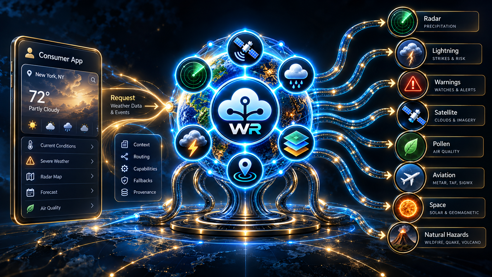

# WeatherRouter

### Eine Idee weiter gedacht.

**Intelligentes Wetter- und Gefahrenrouting für Home Assistant**

**Version 1.0.1 FINAL** · **Native Home-Assistant-Integration** · **Powered by independent weather sources**

*Konzept und Entwicklung · Christian Köhler*

[**Projektseite / Project website**](https://thedaimos.github.io/weather-router-pub/) · [**GitHub-Repository**](https://github.com/TheDaimos/weather-router-pub) · [**Release v1.0.1**](https://github.com/TheDaimos/weather-router-pub/releases/tag/v1.0.1)

**[Deutsch](#deutsch--weatherrouter-entdecken) · [English](#english--discover-weatherrouter)**

---

## 🇩🇪 Deutsch · WeatherRouter entdecken

> **Wetterdaten intelligent verbinden.** Die Anwendung beschreibt ihren Bedarf – WeatherRouter findet unter geeigneten, freigegebenen Quellen die passende Datenressource.

WeatherRouter verbindet Wetter-, Umwelt- und Gefahrenquellen mit einer **zentralen, nachvollziehbaren Consumer-Schnittstelle**. Statt einen Provider fest zu verdrahten, berücksichtigt der Router Datenart, räumliche Abdeckung, Aktualität und fachliche Eignung. Die Entscheidung bleibt über Diagnose- und Provenienzinformationen nachvollziehbar.

### Was WeatherRouter besonders macht

| | Funktion | Ihr Mehrwert |
| :---: | --- | --- |
| 🌐 | **Providerneutrales Routing** | Datenquellen nach fachlichem Bedarf statt nach festgelegtem Namen auswählen. |
| 🛰️ | **39 registrierte Provider** | Acht Fachbereiche, darunter DWD, OPERA und NASA. |
| 🌦️ | **Mehrere Wetterdatenarten** | Niederschlag, Wind, Temperatur und synoptische Datenwege nach Providervertrag. |
| ⚡ | **Progressive Bereitstellung** | Verfügbare Ergebnisse nutzen, ohne andere Provider unnötig zu blockieren. |
| 🔬 | **Diagnose und Provenienz** | Auswahl, Gültigkeit und Datenherkunft nachvollziehen. |
| 🧭 | **Home-Assistant-Erlebnis** | Eigene Seitenleiste, WeatherRouter Lab und integrierte Projektvorstellung. |
| ✨ | **GewitterRadar-Zusammenspiel** | Zusätzliche fachliche Datenwege für unterstützte GewitterRadar-Funktionen. |

### Schnellstart mit HACS

1. In **HACS → Benutzerdefinierte Repositories** dieses Repository als Typ **Integration** hinzufügen:  
   `https://github.com/TheDaimos/weather-router-pub`
2. **WeatherRouter 1.0.1 FINAL** installieren.
3. Home Assistant **vollständig neu starten**.
4. Unter **Einstellungen → Geräte & Dienste → Integration hinzufügen** WeatherRouter auswählen.
5. **WeatherRouter Lab** und die Seitenleiste öffnen; Providerstatus kontrollieren.

**Neuinstallation:** Die 39 registrierten Provider sind grundsätzlich standardmäßig aktiviert. Fachliche, wissenschaftliche, lizenzrechtliche und technische Freigaben bleiben wirksam – *aktiviert* bedeutet nicht automatisch *momentan verfügbar*. Gespeicherte Einstellungen bestehender Installationen werden nicht bewusst überschrieben.

### Mehr erfahren

**[Offizielle Projektseite öffnen](https://thedaimos.github.io/weather-router-pub/)** · **[GitHub-Quellcode ansehen](https://github.com/TheDaimos/weather-router-pub)** · **[FINAL-Release](https://github.com/TheDaimos/weather-router-pub/releases/tag/v1.0.1)**

Direkte Adressen, falls HACS externe Markdown-Links falsch auflöst:

- Projektseite: https://thedaimos.github.io/weather-router-pub/
- Repository: https://github.com/TheDaimos/weather-router-pub

---

## 🇬🇧 English · Discover WeatherRouter

> **Connecting weather data intelligently.** Applications describe what they need; WeatherRouter selects a suitable resource from eligible, authorized sources.

WeatherRouter gives Home Assistant a **provider-neutral gateway for weather, environmental and hazard information**. It evaluates semantic compatibility, geographic coverage, freshness and availability rather than hard-coding a single data provider. Diagnostic and provenance information help explain the result.

### Highlights

| | Capability | Benefit |
| :---: | --- | --- |
| 🌐 | **Provider-neutral routing** | Select sources based on the requested capability. |
| 🛰️ | **39 registered providers** | Eight domains, including DWD, OPERA and NASA. |
| 🌦️ | **Weather data pathways** | Precipitation, wind, temperature and synoptic information, subject to source contracts. |
| ⚡ | **Progressive results** | Make available data useful while independent sources continue updating. |
| 🔬 | **Diagnostics & provenance** | Understand selected sources, validity and fallback decisions. |
| 🧭 | **Home Assistant integration** | Sidebar entry, WeatherRouter Lab and an offline project overview. |
| ✨ | **GewitterRadar interoperability** | Extended weather capabilities for supported GewitterRadar features. |

### Install with HACS

1. Add `https://github.com/TheDaimos/weather-router-pub` under **HACS → Custom repositories** as an **Integration**.
2. Install **WeatherRouter 1.0.1 FINAL**.
3. **Fully restart** Home Assistant.
4. Go to **Settings → Devices & services → Add integration** and select **WeatherRouter**.
5. Open WeatherRouter Lab and check the provider status.

On fresh installations, all 39 registered providers are enabled by default. Scientific, licensing, availability and release gates remain in force; *enabled* does not imply *currently delivering data*.

**[Explore the official website](https://thedaimos.github.io/weather-router-pub/)** · **[Browse the GitHub repository](https://github.com/TheDaimos/weather-router-pub)** · **[FINAL release](https://github.com/TheDaimos/weather-router-pub/releases/tag/v1.0.1)**

---

## Qualität, Datenschutz & Lizenz / Quality, privacy & license

- **Release-Basis / Release baseline:** WR `0.10.327 DEV` · Loader `330` → `1.0.1 FINAL` · `1.0-loader-330`.
- **Qualität / Quality:** Der FINAL-Distributionscheck ist bestanden. Die erweiterte DEV-Testmatrix ist noch nicht vollständig grün; die Funktionsabnahme im Zusammenspiel mit GewitterRadar läuft. / The FINAL distribution check passed; the full DEV test suite and combined functional acceptance remain open.
- **[Öffentlicher Prüfbericht / Public verification report](https://github.com/TheDaimos/weather-router-pub/blob/main/docs/WR_100_FINAL_PUBLIC_VERIFICATION_2026-11-20.md)**
- **Datenschutz / Privacy:** Private Realtests, Export2Git und instanzbezogene Diagnose-Exporte werden nicht öffentlich verteilt. / Private real-world test exports and instance diagnostics are excluded from this distribution.
- **[Gemeinschaftslizenz Modell B / Community License Model B](https://github.com/TheDaimos/weather-router-pub/blob/v1.0.0/LICENSE.md)**

---

**WeatherRouter · Eine Idee weiter gedacht.**

Copyright © 2026 **Christian Köhler** · Konzept und Entwicklung

